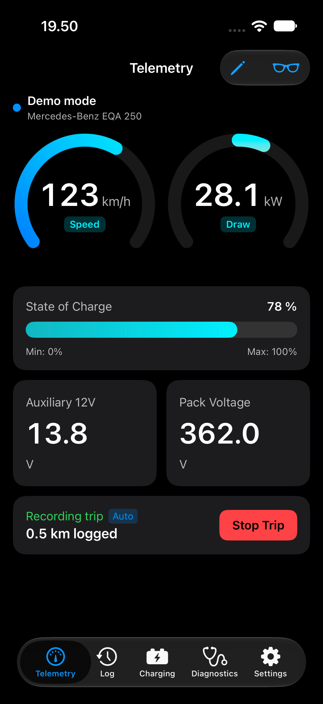

# VoltLink

Native OBD-II diagnostics and live EV telemetry for **iOS / Apple CarPlay**, with an
Android app planned. VoltLink talks to a BLE adapter (Vgate iCar Pro 2S or any
ELM327-compatible dongle), decodes UDS/SAE J1979 telemetry for the
**Mercedes-Benz EQA 250 (2021)** and other EV profiles, and includes a
physics-based demo mode that needs no hardware.

## Repository layout

This is a two-project repository: each platform owns its sources, build tooling,
and tests, and the projects do not share build files.

```text
.
├── ios/        # SwiftUI + CarPlay app, VoltLink.xcodeproj, SwiftPM tests, OKF knowledge bundle
└── android/    # Reserved for the Android app (implementation not started)
```

| Project | Status | Entry point |
| --- | --- | --- |
| iOS / CarPlay | Shipping (Swift 6, iOS 17+, Xcode 16) | [`ios/README.md`](ios/README.md) |
| Android | Planned — placeholder only | [`android/README.md`](android/README.md) |

## Quick start (iOS)

```bash
cd ios
swift test                     # engine + app logic on macOS
open VoltLink.xcodeproj        # build/run the iOS & CarPlay app (Cmd+R)
```

Architecture, features, screenshots, simulator/CarPlay setup, and packaging
instructions live in [`ios/README.md`](ios/README.md).

## Repository-wide files

- [`AGENTS.md`](AGENTS.md) — coding agents' guide for the whole repo (iOS specifics
  live in `ios/`).
- [`.gitignore`](.gitignore), [`LICENSE`](LICENSE).
- [`ios/knowledge/`](ios/knowledge/index.md) — Open Knowledge Format reference for the
  telemetry/diagnostics domain; the Android app will mirror it.


