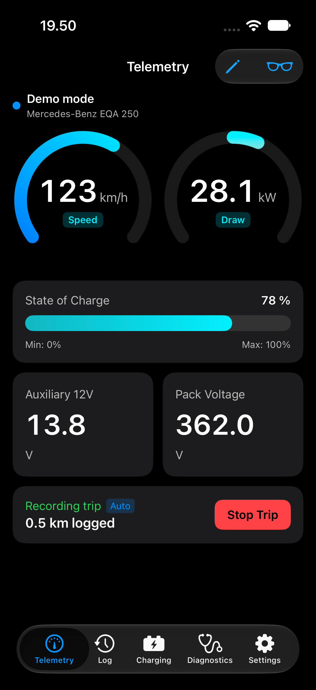
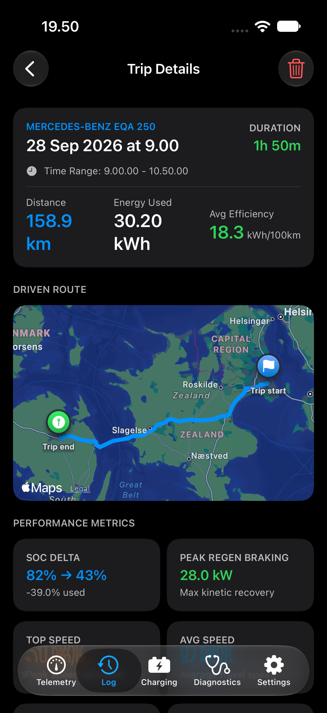
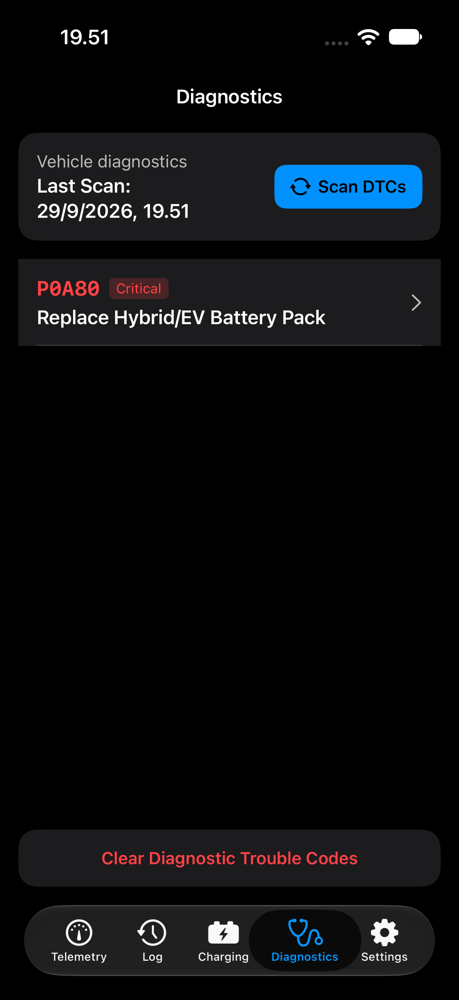

# VoltLink iOS — Swift iOS & CarPlay OBD-II App

> This is the iOS project of the two-project VoltLink repo. See the
> [repository README](../README.md) for the overall layout; the Android app is
> planned under [`android/`](../android/README.md).

[](https://apple.com)
[](https://apple.com)
[](https://swift.org)
[](https://developer.apple.com/swift/)

**VoltLink** is a modern, high-performance native iOS & Apple CarPlay diagnostic and live telemetry suite built with **SwiftUI**, **CoreBluetooth**, **CarPlay**, **Swift Charts**, and **SwiftData**.

Engineered for Bluetooth Low Energy (BLE) OBD-II adapters—specifically optimized for the **Vgate iCar Pro 2S**—VoltLink delivers real-time Unified Diagnostic Services (UDS) telemetry for electric vehicles (including the **Mercedes-Benz EQA 250**, **Volkswagen MEB platform**, and **Hyundai/Kia E-GMP**), alongside standard SAE J1979 OBD-II fallback and a physics-based **Demo / Simulation Engine**.

---

## 📸 App Showcase

<div align="center">

|                                Live Telemetry Dashboard                                |                                   VoltLink Trip History                                   |                          ECU Fault Code Diagnostics Display                          |
| :------------------------------------------------------------------------------------: | :---------------------------------------------------------------------------------------: | :----------------------------------------------------------------------------------: |
|  |  |  |
|               _Real-time speed, power arc, SOC % & Swift Charts stream_                |                _ECU fault scanner with severity rating & Mode 04 clearing_                |                    _Glanceable 4-widget CarPlay driver dashboard_                    |

</div>

---

## 🚀 Quick Start Guide

### Prerequisites

- **macOS Sonoma / Sequoia** with **Xcode 15.0+** or **Xcode 16.0+**
- **iOS 17.0+** iPhone or Simulator
- Optional: **Vgate iCar Pro 2S (BLE)** OBD-II adapter (or use built-in **Demo Mode**)

---

### Option 1: Running & Building via Terminal (CLI)

#### 1. Building for iOS Simulator via Terminal

You can build the iOS app directly from terminal using `xcodebuild`:

```bash
xcodebuild -scheme VoltLink -destination 'platform=iOS Simulator,name=iPhone 17'
```

#### 2. Launching the iOS Simulator from Terminal

```bash
# Open macOS Simulator app
open -a Simulator

# Boot a specific iPhone simulator
xcrun simctl boot "iPhone 17"
```

#### 3. Running Tests via Terminal

```bash
# Run the engine/unit suite via SwiftPM (228 tests)
swift test

# Run the iOS UI smoke test (first-run demo mode + diagnostics)
xcodebuild test -scheme VoltLink \
  -destination 'platform=iOS Simulator,name=iPhone 17' \
  -only-testing:VoltLinkUITests

# Formatting gate used by CI
swift format lint --strict --recursive --configuration .swift-format \
  App CarPlay Core Data Services UI Tests UITests Tools
```

`VoltLink.xcodeproj` is generated by `scratch/make_xcodeproj.py` (shared scheme and
`VoltLinkUITests` target included). Regenerate it after adding files instead of
hand-editing the project file.

---

### Option 2: Running in Xcode (GUI)

1. **Open the Project in Xcode**:

   ```bash
   open VoltLink.xcodeproj
   ```

2. **Select Target & Destination**:
   - Make sure **VoltLink** is selected in the top scheme bar.
   - Select your desired **iOS Simulator** (e.g. **iPhone 17**).

3. **Run the App (`Cmd + R`)**:
   - Xcode will compile `VoltLink.app` and launch it directly in your Simulator!

4. **Build & Run**:
   Press `Cmd + R` to build and launch the application.

5. **Testing Apple CarPlay**:
   While the iOS Simulator is running:
   - In the Simulator menu, go to **I/O -> External Displays -> CarPlay**.
   - A secondary CarPlay display window will open running the native VoltLink CarPlay dashboard!

#### Signing with a Free (Personal) Apple ID

`App/VoltLink.entitlements` requests `com.apple.developer.carplay-driving-task`
and the `group.com.simonkaring.voltlink` App Group, and the widget extension
requests that group too. A free Personal Team can provision neither capability,
so device builds stop at "Cannot create a development provisioning profile".
For local device testing on a free account, generate the project without the
restricted entitlements:

```bash
python3 scratch/make_xcodeproj.py --local-signing
```

The app then installs and runs normally, but CarPlay stays inert and the widget
shows placeholder data (`SharedTelemetryStore` falls back to standard
`UserDefaults` when the app group is missing). Regenerate without the flag once
the project is on a paid Apple Developer Program team and Apple has granted the
CarPlay Driving Task entitlement. Xcode's team selection lives in the generated
project, so export it to survive regeneration:

```bash
VOLTLINK_DEVELOPMENT_TEAM=<TeamID> python3 scratch/make_xcodeproj.py [--local-signing]
```

---

## ⚡ Features & How to Use

### 📱 Live Telemetry Dashboard

- **Speed & Power Gauge**: Circular arc displaying live power draw ($kW$) and regenerative braking (emerald green arc).
- **Battery Pack Monitor**: High Voltage Battery State of Charge (SOC %), State of Health (SOH %), pack temperature, and 12V auxiliary battery voltage.
- **Swift Charts Stream**: Real-time line graph plotting power and speed telemetry.
- **Head-Up Display (HUD) Mode**: Tap the sunglasses icon in the top header to enter mirrored windshield reflection mode for night driving.

---

### 🎮 Demo / Simulation Mode (No Adapter Required!)

Don't have an OBD-II adapter nearby? No problem!

1. VoltLink starts in **Demo Mode** by default.
2. Tap the **Controls** button in the header bar to open the **Demo Control Sheet**.
3. Choose preset scenarios:
   - **City Drive**: Automatic stop-and-go driving with regenerative braking.
   - **Highway Cruise**: High-speed 120 km/h cruising.
   - **DC Fast Charging**: Simulates 100 kW DC fast-charging curve for the EQA 250.
   - **Diagnostic Fault Injection**: Simulates test fault code `P0A80` (Replace EV Battery Pack).
4. Use manual sliders to dynamically adjust simulated vehicle speed and regen force in real-time.

---

### 🔍 Diagnostics & DTC Code Scanner

1. Navigate to the **Diagnostics** tab.
2. Tap **Scan DTCs** to read active and pending fault codes from vehicle ECUs.
3. Tap any code to inspect detailed severity ratings, symptoms, and repair recommendations.
4. Tap **Clear Diagnostic Trouble Codes** to send Mode 04 code clearance commands.

---

### 🚗 Apple CarPlay Support

- When connected to CarPlay, VoltLink displays a 4-widget glanceable dashboard:
  - Live Battery SOC %
  - Realtime Power kW draw/regen
  - Vehicle Speed
  - System Health Status
- The app declares the `CPTemplateApplicationSceneSessionRoleApplication` scene
  in `App/Info.plist` and requests `com.apple.developer.carplay-driving-task`.
  Apple must grant that entitlement for device builds; the Simulator works
  without it. A build signed with a profile that lacks the entitlement will be
  rejected at install time.
- `App/PrivacyInfo.xcprivacy` declares no tracking, the diagnostics data sent to
  the optional AI analyzer, and the UserDefaults/file-timestamp required-reason
  APIs.

---

### 🧩 Widgets, Live Activities & Shortcuts

- A Home Screen widget shows state of charge, estimated range, and charging
  power (small, medium, and Lock Screen accessory families).
- While a trip or charging session is active, a Live Activity mirrors the same
  state on the Lock Screen and in the Dynamic Island.
- Siri / Shortcuts can report charge status and start or stop a trip recording.
- The widget and app share a compact snapshot through the
  `group.com.simonkaring.voltlink` app group. Enable that group for both bundle
  identifiers in the Apple Developer portal; unsigned Simulator builds fall
  back gracefully and show the widget placeholder until it is provisioned.

### ⚙️ Units, Curves & Alerts

- Settings → Units switches distance/speed (km or mi), temperature (°C/°F),
  and power (kW or hp) without touching stored telemetry.
- Settings → Trip Cost Estimate sets a price per kWh; the Log tab then adds a
  monthly cost figure (in the device's currency) next to distance, energy, and efficiency.
- Charging session details chart the recorded power-vs-SOC curve (schema V2).
- Notifications for charging finished, adapter loss during a trip, and fault
  codes are opt-in and requested on first enable.

## 🛠️ Architecture & Tech Stack

- **UI Framework**: SwiftUI + Swift Charts + SF Symbols 5/6, Observation (`@Observable`)
- **BLE Communications**: CoreBluetooth (`CBCentralManager`) + ISO-TP CAN Frame Assembler (`ISO15765Parser`)
- **Concurrency**: Swift 6 language mode for both SPM and Xcode targets; `@MainActor` adapter contracts and a cancellable async polling loop
- **Vehicle Profiles**: Mercedes EQA 250 UDS (ISO 14229 Service 22) PIDs + Generic SAE J1979 Mode 01–0A
- **CarPlay**: `CPTemplateApplicationSceneDelegate` + `CPGridTemplate`
- **Widgets & Live Activities**: WidgetKit extension (`Widgets/`) with a Home Screen status widget and ActivityKit Lock Screen/Dynamic Island presentations, fed by an app-group snapshot
- **Siri & Shortcuts**: App Intents for charge status, start trip, and stop trip
- **Persistence**: Versioned SwiftData schema V2 (`TripModel`, `ChargingSessionModel` with curve samples, `SavedDTCModel`) using inferred lightweight migration
- **Units**: User-selectable metric/imperial distance, °C/°F, and kW/hp through `Core/Units/UnitPreferences`
- **Notifications**: Optional local alerts for charging finished, adapter disconnects during a trip, and newly found fault codes
- **Export**: Trip GPX/CSV and charging-session CSV via `Transferable` share sheets
- **Localization**: `App/Localizable.xcstrings` source catalog (310 extracted strings)

## 📚 Knowledge Bundle (OKF)

`knowledge/` is an [Open Knowledge Format](https://github.com/GoogleCloudPlatform/open-knowledge-format) v0.2 bundle — plain markdown with YAML frontmatter that gives humans and AI agents a navigable reference to the codebase. It covers the architecture, every registered vehicle profile, every telemetry metric, and the curated DTC definitions.

```bash
swift run VoltLinkCLI okf export   # regenerate generated concepts and indexes
swift run VoltLinkCLI okf check    # validate OKF conformance and source drift
```

`knowledge/architecture/` is hand-authored. Profiles, metrics, DTCs, and all `index.md` files are generated from the same Swift registry and seed data the app uses, and `swift test` fails if the checked-in bundle is stale.
